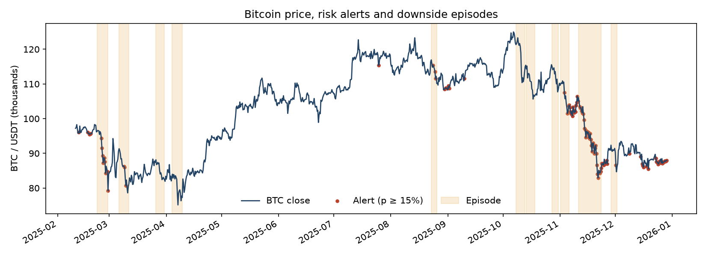

# BTC downside risk and defensive allocation

## Forecasts

Across four test windows in 2025, 71 of 963 forecasts had positive labels (7.37%). Overlapping 72-hour windows can capture the same decline several times. Average precision (AP) measures how well the forecasts rank observations by downside risk.

| Model | AP, price only | AP, price and positioning |
|---|---:|---:|
| Logistic regression | 0.061 | 0.184 |
| XGBoost | 0.066 | 0.084 |
| Regularized XGBoost | 0.078 | 0.098 |

The logistic AP gain was +0.093, undefined (zero positive labels), −0.012 and +0.181 across the four windows. Removing each of the 11 episode intervals in turn from the scored predictions, while holding forecasts fixed, leaves a gain between +0.040 and +0.138. The largest reduction comes from removing the interval beginning November 11. This sensitivity check describes the existing test period. The regularized XGBoost comparison was explored after inspecting the initial test results.

## Alert timing

Overlapping positive-label windows form 11 episodes. An alert means the predicted probability reached 15%. Two episodes had an alert in the 72 hours strictly before episode onset. Four had an alert in the 72 hours strictly before the first 8-hour close at least 5% below the episode's starting close. All 11 had complete pre-breach forecast histories. First-alert leads for the four detected breaches were 16, 48, 24 and 56 hours. These are forecast lead times before allowing for the backtest's one-bar execution delay.

## Allocation

The defensive strategy moves from 100% to 50% BTC when an alert fires, with an 8-hour execution lag and a cost of 10 basis points per unit of turnover. Cash earns zero in the simulation.

| Strategy | Total return | Maximum drawdown |
|---|---:|---:|
| Buy and hold | −8.02% | −33.65% |
| Fixed 75% BTC | −4.81% | −26.30% |
| Realized mean exposure (94.09% BTC) | −7.19% | −31.97% |
| Defensive, net | −9.94% | −32.81% |

The 75% weight is the midpoint of the strategy's two exposures and was added retrospectively as a simple comparator. Its lower exposure matters in a declining market. The 94.09% benchmark matches the realized average exposure and is a retrospective timing diagnostic. Defensive gross return was −7.22%, already close to the exposure-matched benchmark. Trading costs widened the performance gap.
